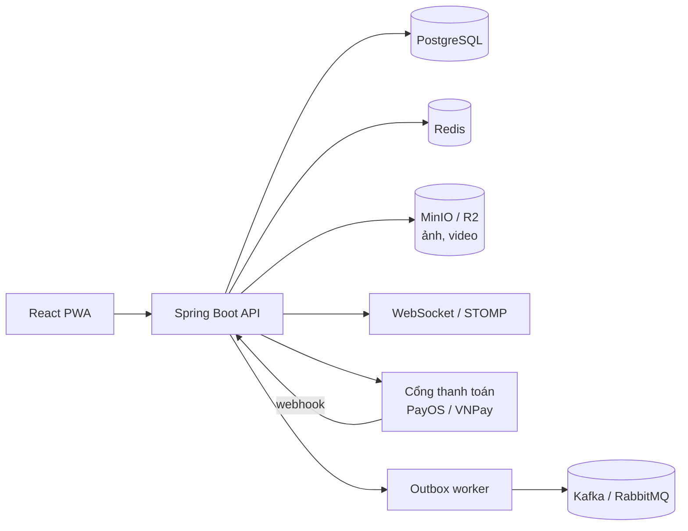
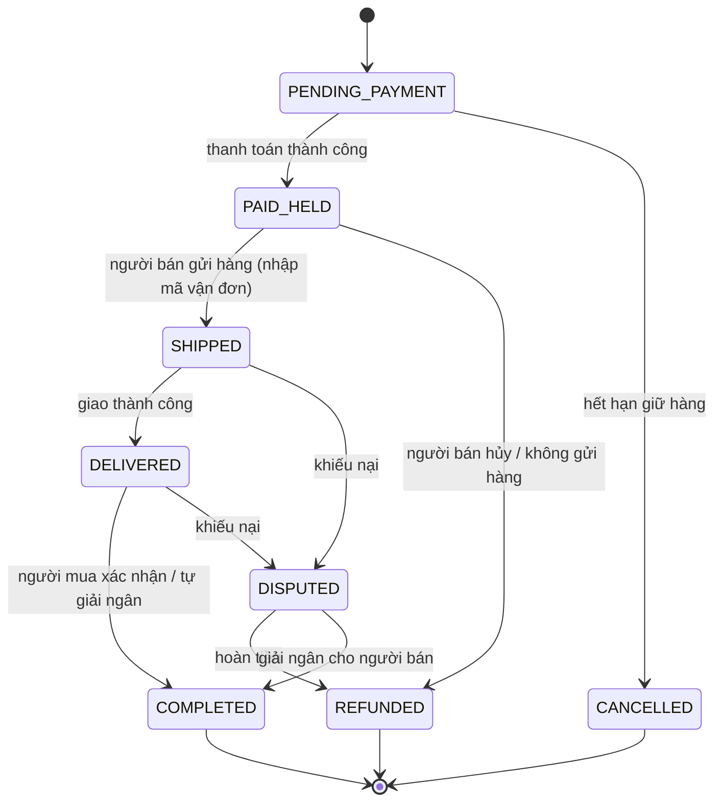

# ReownShop: Chợ 2hand bảo chứng Escrow

> Dự án portfolio thể hiện kỹ năng backend/fullstack thông qua một bài toán thật: **mua bán đồ cũ an toàn giữa cá nhân với cá nhân**, nơi mỗi món hàng là duy nhất và niềm tin là thứ khó nhất.

---

## 0. Trạng thái dự án

| Hạng mục | Trạng thái |
|---|---|
| Thiết kế database (`schema.sql` v2, khớp giao diện) | Xong |
| Giao diện (React + Tailwind, dữ liệu mẫu trong `mocks/`) | Đã dựng xong các màn hình (xem mục 8) |
| Hợp đồng API (suy ra từ giao diện) | **Việc tiếp theo** |
| Backend (Spring Boot) | Chưa bắt đầu |
| Nối FE với API thật | Chưa bắt đầu |
| Load test, CI/CD, deploy | Chưa bắt đầu |

## 1. Mục tiêu dự án

- Không cạnh tranh về số lượng tính năng. Cạnh tranh ở **độ sâu kỹ thuật** và **giải một bài toán khó có thật**.
- Đồ 2hand khác e-commerce thường ở chỗ: số lượng = 1, tình trạng khác nhau, người bán là cá nhân, rủi ro lừa đảo cao.
- Kết quả cuối cùng cần có:
  - Bản demo chạy thật (có link live).
  - Repo có README rõ ràng, sơ đồ kiến trúc, giải thích vì sao chọn giải pháp này.
  - Số liệu thật (load test, `EXPLAIN ANALYZE`, Lighthouse).

## 2. Phạm vi và thứ tự ưu tiên

Giao diện đã đủ các màn hình, nhưng **backend phải chọn trọng tâm**: làm thật sâu phần lõi, phần còn lại ở mức đủ chạy.

| Mức ưu tiên | Hạng mục | Vai trò |
|---|---|---|
| **Bắt buộc (lõi)** | Chống tranh mua món hàng duy nhất | Bài toán đồng thời (concurrency) |
| **Bắt buộc (lõi)** | Escrow: thanh toán, giữ tiền, giải ngân, hoàn tiền, state machine, sổ cái | Nghiệp vụ lõi, thanh toán thật |
| **Bắt buộc (lõi)** | Tìm kiếm tiếng Việt không dấu | Trải nghiệm + kỹ thuật |
| Nên có | Auth, tin đăng + upload ảnh, trả giá | Nền tảng của luồng mua bán |
| Nên có | Chat realtime, thông báo | Thể hiện WebSocket |
| Nên có | Khiếu nại, đánh giá | Hoàn thiện vòng đời đơn hàng |
| Mức đủ chạy | Yêu thích, địa chỉ, cài đặt, ví/rút tiền, nháp tin, lưu tìm kiếm | Chủ yếu là CRUD |
| Nếu còn thời gian | AI đăng tin (ảnh → tiêu đề, danh mục, giá), tìm kiếm bằng ảnh, phát hiện tin đáng ngờ | Điểm nhấn |
| Về sau | Trang quản trị (admin), Kafka/RabbitMQ, microservices | Chỉ làm khi thật sự cần |

> Ba hạng mục "lõi" đã đủ để kể một câu chuyện kỹ thuật trọn vẹn trong phỏng vấn. Đừng dồn thời gian cho phần CRUD.

## 3. Tech stack

| Tầng | Công nghệ | Ghi chú |
|---|---|---|
| Backend | Spring Boot (Java) + Spring Data JPA | Vừa học vừa có sản phẩm, stack nhiều công ty tuyển |
| Database | PostgreSQL + Flyway (migration) | Dùng `unaccent`, `pg_trgm`; PostGIS nếu lọc theo khoảng cách |
| Cache / khóa | Redis | Lớp chặn sớm cho giữ hàng, rate limit |
| Lưu ảnh/video | MinIO hoặc Cloudflare R2 | Ảnh tin đăng, bằng chứng khiếu nại |
| Tìm kiếm | PostgreSQL full-text trước, Elasticsearch / pgvector sau | Đừng dựng Elasticsearch quá sớm |
| Realtime | WebSocket (STOMP) | Chat, cập nhật trạng thái đơn/offer |
| Thanh toán | PayOS / VNPay / MoMo (sandbox) | Webhook, retry, đối soát |
| Message queue | Kafka / RabbitMQ (tùy chọn) | Chỉ khi dùng Outbox pattern |
| Frontend | React + TypeScript, Tailwind, shadcn/ui, TanStack Query | Mobile-first, đã dựng với dữ liệu mẫu |
| Hạ tầng | Docker Compose, CI/CD, deploy demo live | Chạy một lệnh là lên |
| Giám sát | Prometheus + Grafana (cơ bản) | Điểm cộng |
| Test tải | k6 hoặc JMeter | Đưa số liệu vào README |

## 4. Kiến trúc

Bắt đầu bằng **modular monolith** (một ứng dụng, chia module rõ ràng). Chỉ tách service khi có lý do. Nếu tách, 3 đến 4 service có chủ đích là đủ, không cần 20 microservice.

Các module gợi ý: `user`, `listing`, `search`, `offer`, `order`, `payment`, `wallet-ledger`, `chat`, `notification`, `review`, `dispute`, `report`.

## 5. Thiết kế database

Schema đầy đủ nằm trong [`schema.sql`](./schema.sql) (PostgreSQL, comment tiếng Việt từng dòng, đã kiểm tra cú pháp). Phiên bản 2 đã bổ sung để **khớp với giao diện**.

### 5.1. Nhóm bảng

| Nhóm | Bảng |
|---|---|
| Người dùng | `users`, `user_verifications`, `addresses`, `user_settings`, `wallets` |
| Tin đăng | `categories`, `listings`, `listing_images`, `listing_drafts`, `favorites`, `saved_searches` |
| Trả giá | `offers` |
| Đơn hàng | `orders`, `order_status_history` |
| Tiền | `payments`, `withdrawals`, `ledger_entries` |
| Khiếu nại | `disputes`, `dispute_messages`, `dispute_evidence` |
| Tương tác | `reviews`, `conversations`, `messages`, `notifications` |
| Vận hành | `reports`, `outbox_events` |

### 5.2. Những gì đã thêm so với phiên bản đầu

| Từ giao diện | Phần schema tương ứng |
|---|---|
| Yêu thích, nhãn "Giảm giá" | `favorites` (lưu `price_at_save` để so với giá hiện tại) |
| Thông báo theo nhóm, chấm chưa đọc | `notifications` (`type`, `ref_type`, `ref_id`, `is_read`) |
| Nhiều địa chỉ nhận hàng, đặt mặc định | `addresses` + unique index chỉ cho phép 1 địa chỉ mặc định |
| Khiếu nại có timeline, bằng chứng, trao đổi | `disputes`, `dispute_messages`, `dispute_evidence` |
| Giao hàng, mã vận đơn, hẹn gặp trực tiếp | `orders`: `delivery_method`, `carrier`, `tracking_code`, `shipping_address`, các mốc thời gian |
| Phí vận chuyển, tổng tiền | `orders`: `shipping_fee`, `total_amount` + `CHECK (total = giá + ship + phí sàn)` |
| Giá thấp nhất chấp nhận (chỉ người bán thấy) | `listings.min_accept_price`, `allow_offers` |
| Giá mua mới gạch ngang trên thẻ | `listings.retail_price` |
| Bản nháp tin đăng, tự lưu | `listing_drafts` (JSONB) |
| Đẩy tin, lượt xem | `listings.bumped_at`, `view_count` |
| Xác minh tài khoản nhiều bước | `user_verifications`, `users.verification` |
| Thẻ chọn nhanh và ảnh trong đánh giá | `reviews.tags`, `reviews.image_urls` |
| Rút tiền | `withdrawals`, `ledger_entries.withdrawal_id` |
| Chat: ảnh, thẻ đề nghị giá, cập nhật đơn, cảnh báo, đã đọc | `messages`: `type`, `image_url`, `offer_id`, `order_id`, `is_flagged`, `read_at` |
| Cài đặt thông báo, giao diện sáng/tối | `user_settings` |
| Đăng nhập Google | `users.google_id`, `password_hash` cho phép NULL |
| Thống kê hồ sơ người bán | `users.completed_orders`, `response_rate`, `avg_response_minutes` |
| Báo cáo người dùng, admin xử lý | `reports.reported_user_id`, `resolved_by` |

### 5.3. Các quyết định thiết kế quan trọng

1. **Chống hai người mua cùng một món**: partial unique index `uq_one_active_order_per_listing` trên `orders (listing_id)` với các trạng thái đang hoạt động. DB tự từ chối đơn thứ hai, không phụ thuộc code ứng dụng.
2. **Optimistic locking**: `listings.version` và `wallets.version` (dùng `@Version` của JPA). Redis chỉ là lớp chặn sớm cho nhanh.
3. **Idempotency**: `orders.idempotency_key` là `UNIQUE`, bấm mua nhiều lần chỉ ra một đơn. `payments.provider_ref` là `UNIQUE`, webhook gửi lặp không bị xử lý hai lần.
4. **Tiền dùng `BIGINT` (đồng VND)**, không dùng float. `CHECK` chặn số tiền sai ngay ở DB.
5. **Sổ cái chỉ thêm, không sửa/xóa** (`ledger_entries`). Hai unique index `uq_ledger_hold_once` và `uq_ledger_release_once` chặn giữ tiền hoặc giải ngân hai lần cho cùng một đơn.
6. **Ảnh chụp địa chỉ giao hàng** (`orders.shipping_address` dạng JSONB): người dùng sửa địa chỉ sau này không làm đổi đơn cũ.
7. **Ràng buộc trạng thái bằng `CHECK`**: tên trạng thái trong DB, backend và giao diện phải **giống hệt nhau** (xem mục 7).
8. **Lịch sử trạng thái** (`order_status_history`): phục vụ audit và giải quyết khiếu nại.
9. **Tìm kiếm không dấu**: `unaccent` + `pg_trgm` với GIN index.
10. **Outbox** (`outbox_events`): ghi đơn và event trong cùng một transaction, worker riêng đẩy sang message queue. Bỏ qua nếu chưa dùng queue.
11. **Dữ liệu nhạy cảm**: không lưu số giấy tờ tùy thân (chỉ lưu trạng thái xác minh); số tài khoản ngân hàng ở bản demo chỉ lưu dạng đã che, hệ thống thật phải mã hóa hoặc tokenize.

### 5.4. Những chỗ cần tự cân nhắc
- Số dư trong `wallets` là dữ liệu dẫn xuất từ `ledger_entries`. Nếu giữ cả hai, phải cập nhật trong **cùng một transaction**.
- `trust_score`, `completed_orders`, `response_rate`, `avg_response_minutes` là số liệu tổng hợp, nên tính lại bằng job định kỳ thay vì cập nhật mỗi lần có sự kiện.
- Chỉ thêm index sau khi có dữ liệu giả vài trăm nghìn dòng và đã chạy `EXPLAIN ANALYZE`.
- Hoàn tiền một phần trong khiếu nại cần sổ cái ghi cả `REFUND` (cho người mua) lẫn `RELEASE` (phần còn lại cho người bán); unique index hiện tại cho phép nhiều dòng `REFUND` nhưng chỉ một `RELEASE`.

## 6. Luồng nghiệp vụ lõi: Escrow

Điểm cần xử lý:
- `reserved_until`: hết hạn mà chưa thanh toán thì job tự hủy đơn và nhả hàng.
- `auto_release_at`: người mua im lặng quá N ngày thì tự giải ngân cho người bán.
- Webhook thanh toán phải **idempotent**, có retry, và có đối soát (reconciliation) định kỳ.
- Mọi chuyển trạng thái đều ghi `order_status_history`; mọi di chuyển tiền đều ghi `ledger_entries`.
- Dùng Spring State Machine hoặc tự viết, nhưng phải có **bảng chuyển trạng thái hợp lệ** và test cho từng đường đi sai.
- Khi đơn sang `DISPUTED`, **dừng đồng hồ tự giải ngân**; tiền vẫn nằm ở trạng thái giữ cho tới khi có kết quả khiếu nại.

## 7. Quy ước dùng chung giữa DB, backend và giao diện

Các giá trị dưới đây phải giữ nguyên ở cả ba nơi để tránh lỗi khó thấy khi nối FE với API.

| Đối tượng | Giá trị |
|---|---|
| Trạng thái đơn | `PENDING_PAYMENT`, `PAID_HELD`, `SHIPPED`, `DELIVERED`, `COMPLETED`, `DISPUTED`, `REFUNDED`, `CANCELLED` |
| Trạng thái offer | `PENDING`, `ACCEPTED`, `REJECTED`, `COUNTERED`, `EXPIRED` |
| Trạng thái tin | `ACTIVE`, `RESERVED`, `SOLD`, `HIDDEN` |
| Tình trạng đồ | `NEW_99` (Như mới), `VERY_GOOD` (Rất tốt), `GOOD` (Tốt), `FAIR` (Trầy xước) |
| Loại giao dịch ví | `HOLD`, `RELEASE`, `REFUND`, `FEE`, `WITHDRAW` |
| Phương thức giao hàng | `SHIPPING`, `MEETUP` |
| Trạng thái khiếu nại | `OPEN`, `REVIEWING`, `WAITING_SELLER`, `RESOLVED` |
| Loại thông báo | `ORDER`, `OFFER`, `MESSAGE`, `SYSTEM` |
| Loại tin nhắn | `TEXT`, `IMAGE`, `OFFER`, `ORDER_UPDATE`, `SYSTEM` |
| Định dạng tiền | số nguyên VND ở backend; giao diện hiển thị `17.800.000đ` |

> Nếu giao diện (`mocks/`) đang dùng tên khác, hãy **đổi giao diện theo bảng này** (hoặc sửa bảng và `schema.sql` cho khớp), đừng để hai bên lệch nhau.

## 8. Giao diện (UI/UX)

Giao diện phải **thay thế việc cầm nắm món hàng và tạo niềm tin**. Hệ thống thiết kế: tông teal làm màu chủ đạo, cam hổ phách làm điểm nhấn, font Be Vietnam Pro, bo góc 12 đến 16px, icon dạng line, hỗ trợ dark mode.

### 8.1. Nguyên tắc
- **Mobile-first**, cân nhắc PWA. Desktop dùng bố cục 3 cột: sidebar bộ lọc trái, lưới sản phẩm giữa (4 đến 5 cột), cột "Đang theo dõi" phải (chỉ hiện từ màn xl trở lên).
- **Ảnh là trung tâm**: lưới ảnh lớn, tỉ lệ đồng nhất, giá in đậm; trang chi tiết có gallery vuốt và zoom.
- **Niềm tin ở mọi nơi**: huy hiệu người bán (xác minh, điểm uy tín, số đơn thành công, thời gian phản hồi), nhãn Escrow cạnh nút mua và trên từng thẻ, nhãn tình trạng có màu.
- **Giảm ma sát khi đăng tin**: chụp ảnh → AI gợi ý → chỉnh nhanh → đăng; thanh tiến trình, tự lưu nháp.

### 8.2. Danh sách màn hình

| Đợt | Màn hình |
|---|---|
| Đầu | Trang chủ/tìm kiếm, chi tiết sản phẩm, theo dõi đơn hàng |
| 2 | Thanh toán, trả giá, đăng nhập/đăng ký |
| A | Đăng tin, dashboard người bán, ví, hồ sơ người bán |
| B | Chat, khiếu nại, đánh giá, thông báo, cài đặt tài khoản, yêu thích |
| Chưa làm (tùy chọn) | Trang quản trị (admin), trang "Tìm hiểu về Escrow", điều khoản, trung tâm trợ giúp |

### 8.3. Chi tiết nên giữ
- Timeline trạng thái đơn khớp đúng state machine ở mục 6 và đồng hồ đếm ngược giữ hàng.
- Skeleton loading, optimistic UI, empty state có hướng dẫn, lỗi dễ hiểu bằng tiếng Việt.
- Banner nhắc an toàn trong chat và cảnh báo khi tin nhắn có dấu hiệu kéo ra ngoài nền tảng.
- Accessibility cơ bản và điểm Lighthouse cao.
- Không nhắc "Escrow" quá nhiều chỗ: giữ banner và huy hiệu trên thẻ, gộp nút trên header vào mục tài khoản.

## 9. Hợp đồng API (bước tiếp theo)

Danh sách endpoint sẽ được **suy ra từ chính giao diện**: mỗi màn hình cần dữ liệu gì thì có endpoint tương ứng. Gợi ý nhóm API:

| Nhóm | Ví dụ endpoint |
|---|---|
| Auth | đăng ký, đăng nhập, đăng nhập Google, làm mới token, quên mật khẩu |
| Tin đăng | tìm kiếm + lọc + sắp xếp, chi tiết, tạo/sửa/ẩn, đẩy tin, nháp, upload ảnh |
| Yêu thích / lưu tìm kiếm | thả tim, bỏ thích, danh sách |
| Trả giá | tạo, chấp nhận, từ chối, trả giá lại, danh sách của tôi |
| Đơn hàng | tạo (có idempotency key), chi tiết, đã gửi hàng, xác nhận đã nhận, hủy |
| Thanh toán | tạo link thanh toán, webhook, trạng thái |
| Ví | số dư, lịch sử, rút tiền |
| Khiếu nại | mở, bổ sung bằng chứng, trao đổi, kết quả |
| Chat | danh sách cuộc trò chuyện, tin nhắn, WebSocket |
| Thông báo | danh sách, đánh dấu đã đọc |
| Hồ sơ / cài đặt | hồ sơ công khai, địa chỉ, xác minh, thông báo, giao diện |
| Đánh giá | tạo, danh sách theo người bán |

Quy ước chung: phân trang theo con trỏ cho danh sách dài, mã lỗi nhất quán, mọi API thay đổi tiền hoặc trạng thái đều idempotent.

## 10. Kiểm thử và số liệu cần đưa vào README

| Loại | Cần chứng minh |
|---|---|
| Test đồng thời | N người cùng mua 1 món, đúng 1 đơn thành công, không bán trùng |
| Test idempotency | Gửi trùng request tạo đơn và trùng webhook, kết quả không đổi |
| Test state machine | Mọi chuyển trạng thái sai đều bị từ chối |
| Test sổ cái | Tổng ledger luôn khớp với số dư ví; không giải ngân hai lần |
| Test khiếu nại | Đơn `DISPUTED` không bị tự giải ngân; hoàn tiền một phần ghi đúng sổ cái |
| Test hết hạn | Đơn quá hạn giữ hàng tự hủy và nhả tin; offer quá hạn chuyển `EXPIRED` |
| Load test (k6/JMeter) | Ghi rõ cấu hình máy, số request/giây, độ trễ p95/p99 |
| `EXPLAIN ANALYZE` | So sánh truy vấn trước và sau khi thêm index |
| Lighthouse | Điểm hiệu năng, accessibility trên mobile |

Số liệu phải là **số đo thật** kèm điều kiện đo, không ước đoán.

## 11. DevOps và đóng gói

- `docker compose up` chạy toàn bộ hệ thống một lệnh (app, PostgreSQL, Redis, MinIO, ...).
- CI/CD: build, test, lint tự động mỗi lần push.
- Có bản demo live, có tài khoản demo và dữ liệu mẫu (seed).
- Quản lý migration DB bằng Flyway; `schema.sql` là bản thiết kế gốc để chuyển thành các file migration.
- Không commit secret, dùng biến môi trường.
- Monitoring cơ bản bằng Prometheus + Grafana (điểm cộng).

## 12. Bảo mật và chống lừa đảo

- Mật khẩu chỉ lưu hash (BCrypt/Argon2), dùng JWT hoặc session an toàn.
- Xác minh chữ ký webhook của cổng thanh toán, không tin dữ liệu từ client về số tiền; backend tự tính `total_amount`.
- Rate limit các API nhạy cảm (đăng nhập, tạo đơn, chat, upload).
- Kiểm soát quyền: chỉ người bán sửa tin của mình, chỉ các bên của đơn mới xem đơn và khiếu nại, `min_accept_price` không bao giờ trả về cho người mua.
- Kiểm tra loại và dung lượng file upload, đặt tên ngẫu nhiên, không tin tên file từ client.
- Phát hiện tin đáng ngờ bằng rule đơn giản: giá thấp bất thường so với mặt bằng, tài khoản mới đăng hàng loạt, ảnh trùng (`phash`).
- Lọc từ khóa kéo người dùng ra ngoài nền tảng trong chat (đánh dấu `is_flagged`).
- Không lưu giấy tờ tùy thân; thông tin tài khoản ngân hàng phải mã hóa nếu làm thật.

## 13. Lộ trình

| Giai đoạn | Nội dung | Trạng thái |
|---|---|---|
| 0 | Thiết kế schema, dựng giao diện với dữ liệu mẫu | Xong |
| 1 | Chốt hợp đồng API từ giao diện; dựng khung Spring Boot, Docker Compose, Flyway | Tiếp theo |
| 2 | Auth: đăng ký, đăng nhập, JWT, phân quyền | |
| 3 | Tin đăng, upload ảnh, tìm kiếm không dấu, yêu thích, địa chỉ | |
| 4 | **Đặt mua, giữ hàng, chống tranh mua, test đồng thời** | |
| 5 | **Thanh toán sandbox, webhook, sổ cái, state machine escrow, job hết hạn và tự giải ngân** | |
| 6 | Trả giá, chat realtime, thông báo, đánh giá, khiếu nại, ví/rút tiền | |
| 7 | Nối giao diện với API thật (thay `mocks/`), sửa lệch giữa hai phía | |
| 8 | Load test, tối ưu index, CI/CD, deploy, viết README và ADR | |
| 9 (tùy chọn) | AI đăng tin, tìm kiếm bằng ảnh, phát hiện tin đáng ngờ, trang admin, Outbox + queue | |

> Làm theo **lát cắt dọc**: mỗi giai đoạn hoàn thành một tính năng chạy được từ API đến DB rồi mới sang giai đoạn kế. Phần lõi (giai đoạn 4 và 5) nên làm sớm, ngay sau auth và tin đăng.

## 14. Lưu ý pháp lý và phạm vi

- Đây là **dự án demo kỹ thuật**, không vận hành thật.
- Chợ đồ cũ có rủi ro hàng cấm, hàng giả, gian lận thanh toán. Trong README công khai nên ghi rõ phần kiểm duyệt chỉ ở mức cơ bản.
- Không dùng tiền thật; chỉ dùng môi trường sandbox của cổng thanh toán.

## 15. Cấu trúc README của repo (khi hoàn thiện)

1. Giới thiệu và ảnh/GIF demo
2. Link demo live và tài khoản thử
3. Tính năng nổi bật
4. Sơ đồ kiến trúc
5. **ADR**: vì sao chọn giải pháp này mà không chọn giải pháp khác (ví dụ: partial unique index so với chỉ dùng Redis lock; modular monolith so với microservices; sổ cái chỉ thêm so với chỉ cập nhật số dư)
6. Thiết kế database và luồng escrow
7. Kết quả test và benchmark (kèm điều kiện đo)
8. Hướng dẫn chạy (`docker compose up`)
9. Hạn chế đã biết và hướng phát triển

## 16. Checklist hoàn thành

- [x] Schema v2 khớp giao diện, kiểm tra cú pháp
- [x] Giao diện các màn hình chính với dữ liệu mẫu
- [ ] Hợp đồng API chốt xong, tên trạng thái khớp mục 7
- [ ] Schema chuyển thành migration Flyway, chạy sạch từ đầu
- [ ] Không thể bán trùng một món (có test chứng minh)
- [ ] Luồng escrow chạy đủ: thanh toán, giữ tiền, giao, xác nhận, giải ngân, khiếu nại, hoàn tiền
- [ ] Webhook idempotent, có đối soát
- [ ] Job tự hủy đơn quá hạn, tự giải ngân, hết hạn offer
- [ ] Tìm kiếm tiếng Việt không dấu hoạt động
- [ ] Giao diện nối API thật, không còn dùng mock
- [ ] Có số liệu load test, `EXPLAIN ANALYZE`, Lighthouse
- [ ] `docker compose up` chạy một lệnh, có CI/CD
- [ ] Demo live và README đầy đủ (kiến trúc, ADR, benchmark)