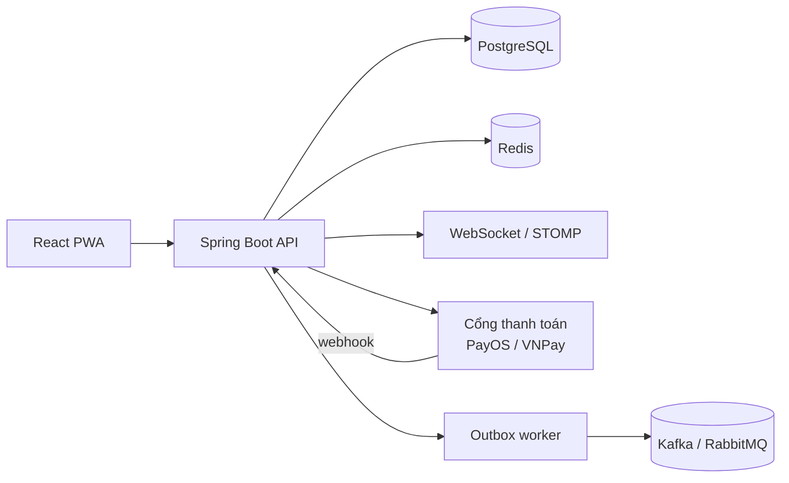
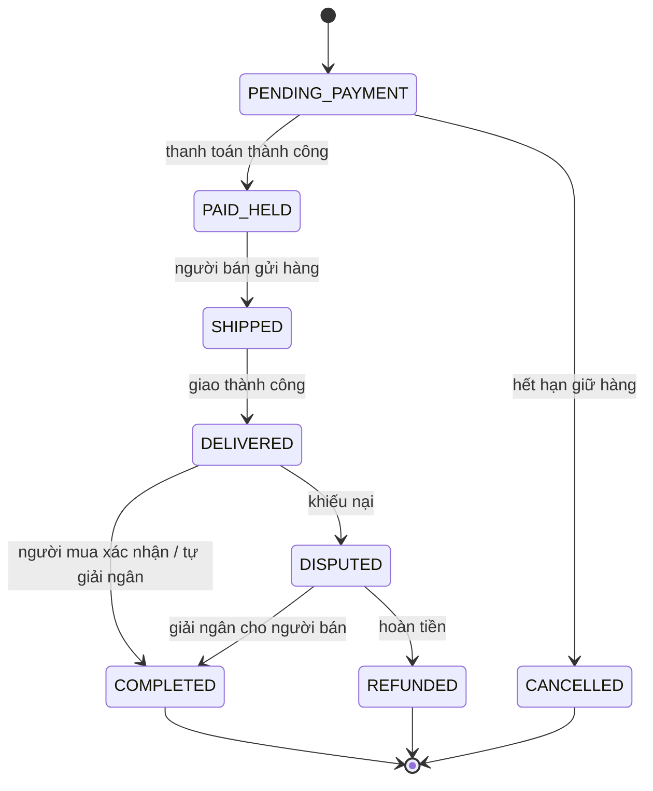

# Chợ đồ 2hand có Escrow

> Dự án portfolio thể hiện kỹ năng backend/fullstack thông qua một bài toán thật: **mua bán đồ cũ an toàn giữa cá nhân với cá nhân**, nơi mỗi món hàng là duy nhất và niềm tin là thứ khó nhất.

---

## 1. Mục tiêu dự án

- Không cạnh tranh về số lượng tính năng. Cạnh tranh ở **độ sâu kỹ thuật** và **giải một bài toán khó có thật**.
- Đồ 2hand khác e-commerce thường ở chỗ: số lượng = 1, tình trạng khác nhau, người bán là cá nhân, rủi ro lừa đảo cao.
- Kết quả cuối cùng cần có:
  - Bản demo chạy thật (có link live).
  - Repo có README rõ ràng, sơ đồ kiến trúc, giải thích vì sao chọn giải pháp này.
  - Số liệu thật (load test, EXPLAIN ANALYZE, Lighthouse).

## 2. Chọn phạm vi (quan trọng nhất)

Đừng làm hết. Chọn **1 xương sống kỹ thuật** làm thật sâu, phần còn lại để mức đơn giản.

| Mức ưu tiên | Hạng mục | Vai trò |
|---|---|---|
| **Bắt buộc** | Chống tranh mua món hàng duy nhất | Bài toán đồng thời (concurrency) |
| **Bắt buộc** | Escrow (giữ tiền trung gian) + state machine đơn hàng | Nghiệp vụ lõi, thanh toán thật |
| **Bắt buộc** | Tìm kiếm tiếng Việt không dấu | Trải nghiệm + kỹ thuật |
| Nên có | Trả giá (offer / counter-offer) | Đặc thù của đồ cũ |
| Nên có | Chat realtime | Thể hiện WebSocket |
| Nếu còn thời gian | AI đăng tin (ảnh → tiêu đề, danh mục, giá) | Điểm nhấn |
| Nếu còn thời gian | Tìm kiếm bằng hình ảnh, phát hiện tin đáng ngờ | Điểm nhấn |
| Có thể bỏ | Kafka/RabbitMQ, microservices | Chỉ làm khi thật sự cần |

> Lời khuyên: ba hạng mục "Bắt buộc" đã đủ để kể một câu chuyện kỹ thuật trọn vẹn trong phỏng vấn.

## 3. Tech stack

| Tầng | Công nghệ | Ghi chú |
|---|---|---|
| Backend | Spring Boot (Java) + Spring Data JPA | Vừa học vừa có sản phẩm, stack nhiều công ty tuyển |
| Database | PostgreSQL | Dùng `unaccent`, `pg_trgm`; PostGIS nếu lọc theo khoảng cách |
| Cache / khóa | Redis | Lớp chặn sớm cho giữ hàng, rate limit |
| Tìm kiếm | PostgreSQL full-text trước, Elasticsearch / pgvector sau | Đừng dựng Elasticsearch quá sớm |
| Realtime | WebSocket (STOMP) | Chat, cập nhật trạng thái đơn/offer |
| Thanh toán | PayOS / VNPay / MoMo (sandbox) | Webhook, retry, đối soát |
| Message queue | Kafka / RabbitMQ (tùy chọn) | Chỉ khi dùng Outbox pattern |
| Frontend | React + TypeScript, Tailwind, shadcn/ui, TanStack Query | Mobile-first |
| Hạ tầng | Docker Compose, CI/CD, deploy demo live | Chạy một lệnh là lên |
| Giám sát | Prometheus + Grafana (cơ bản) | Điểm cộng |
| Test tải | k6 hoặc JMeter | Đưa số liệu vào README |

## 4. Kiến trúc

Bắt đầu bằng **modular monolith** (một ứng dụng, chia module rõ ràng). Chỉ tách service khi có lý do. Nếu tách, 3 đến 4 service có chủ đích là đủ, không cần 20 microservice.

Các module gợi ý: `user`, `listing`, `search`, `offer`, `order`, `payment`, `wallet-ledger`, `chat`, `review`, `report`.

## 5. Thiết kế database

Schema đầy đủ có trong file [`schema.sql`](./schema.sql) (PostgreSQL, comment tiếng Việt từng dòng). Các quyết định chính:

1. **Chống hai người mua cùng một món**: partial unique index trên `orders (listing_id)` với các trạng thái đang hoạt động. DB tự từ chối đơn thứ hai, không phụ thuộc code ứng dụng.
2. **Optimistic locking**: cột `listings.version` (dùng `@Version` của JPA). Redis chỉ là lớp chặn sớm cho nhanh.
3. **Idempotency**: `orders.idempotency_key` là `UNIQUE`, bấm mua nhiều lần chỉ ra một đơn. `payments.provider_ref` là `UNIQUE`, webhook gửi lặp không bị xử lý hai lần.
4. **Tiền dùng `BIGINT` (đồng VND)**, không dùng float.
5. **Sổ cái chỉ thêm, không sửa/xóa** (`ledger_entries`): số dư luôn truy ngược được. `wallets` tách `available` và `held`.
6. **Lịch sử trạng thái** (`order_status_history`): phục vụ audit và giải quyết khiếu nại.
7. **Tìm kiếm không dấu**: `unaccent` + `pg_trgm` với GIN index.
8. **Outbox** (`outbox_events`): ghi đơn và event trong cùng một transaction, worker riêng đẩy sang message queue. Bỏ qua nếu chưa dùng queue.

Những chỗ cần tự cân nhắc:
- Số dư trong `wallets` là dữ liệu dẫn xuất từ `ledger_entries`. Nếu giữ cả hai, phải cập nhật trong **cùng một transaction**.
- `trust_score` nên tính lại bằng job định kỳ, không cập nhật mỗi lần có review.
- Chỉ thêm index sau khi có dữ liệu giả vài trăm nghìn dòng và đã chạy `EXPLAIN ANALYZE`.

## 6. Luồng nghiệp vụ lõi: Escrow

Điểm cần xử lý:
- `reserved_until`: hết hạn mà chưa thanh toán thì job tự hủy đơn và nhả hàng.
- `auto_release_at`: người mua im lặng quá N ngày thì tự giải ngân cho người bán.
- Webhook thanh toán phải **idempotent**, có retry, và có đối soát (reconciliation) định kỳ.
- Mọi chuyển trạng thái đều ghi `order_status_history`; mọi di chuyển tiền đều ghi `ledger_entries`.
- Dùng Spring State Machine hoặc tự viết, nhưng phải có **bảng chuyển trạng thái hợp lệ** và test cho từng đường đi sai.

## 7. Trả giá (offer)

- Bảng `offers` có `parent_id` để dựng chuỗi trả giá qua lại, `expires_at` để tự hết hạn.
- Khi offer được chấp nhận, giá chốt được copy sang `orders.price`.
- UI gợi ý nhanh các mức (-5%, -10%) và cập nhật trạng thái realtime.

## 8. Giao diện (UI/UX)

Giao diện phải **thay thế việc cầm nắm món hàng và tạo niềm tin**.

Nguyên tắc:
- **Mobile-first**, cân nhắc PWA.
- **Ảnh là trung tâm**: lưới ảnh lớn, tỉ lệ đồng nhất, giá in đậm; trang chi tiết có gallery vuốt và zoom.
- **Niềm tin ở mọi nơi**: huy hiệu người bán (xác minh, điểm uy tín, số đơn thành công, thời gian phản hồi), nhãn "Được bảo vệ bởi escrow" cạnh nút mua, nhãn tình trạng có màu và ảnh khuyết điểm.
- **Giảm ma sát khi đăng tin**: chụp ảnh → AI gợi ý → chỉnh nhanh → đăng; có thanh tiến trình và tự lưu nháp.

Các màn hình:

| Màn hình | Điểm đáng đầu tư |
|---|---|
| Trang chủ / tìm kiếm | Ô tìm kiếm lớn, gợi ý khi gõ, bộ lọc dạng bottom sheet, lưu tìm kiếm |
| Chi tiết sản phẩm | Gallery, thông tin người bán, nút Mua ngay / Trả giá / Chat, sản phẩm tương tự |
| Trả giá | Mức gợi ý nhanh, trạng thái offer realtime |
| Chat | Realtime, thẻ sản phẩm trên đầu cuộc chat, đề nghị giá ngay trong chat |
| Thanh toán / theo dõi đơn | **Timeline trạng thái đơn** (khớp state machine), **đồng hồ đếm ngược giữ hàng** |
| Khiếu nại | Luồng đơn giản, upload ảnh bằng chứng |
| Dashboard người bán | Tin đang bán, offer chờ xử lý, doanh thu, ví |

Chi tiết tạo cảm giác chuyên nghiệp: skeleton loading, optimistic UI, empty state có hướng dẫn, lỗi dễ hiểu bằng tiếng Việt, dark mode, accessibility cơ bản, điểm Lighthouse cao.

Lời khuyên: tham khảo Chợ Tốt, Vinted, Mercari rồi thiết kế lại theo hướng riêng. Chọn **một** bảng màu và **một** font, dùng nhất quán. Vẽ wireframe trên Figma trước khi code.

## 9. Kiểm thử và số liệu cần đưa vào README

| Loại | Cần chứng minh |
|---|---|
| Test đồng thời | N người cùng mua 1 món, đúng 1 đơn thành công, không bán trùng |
| Test idempotency | Gửi trùng request tạo đơn và trùng webhook, kết quả không đổi |
| Test state machine | Mọi chuyển trạng thái sai đều bị từ chối |
| Test sổ cái | Tổng ledger luôn khớp với số dư ví |
| Load test (k6/JMeter) | Ghi rõ cấu hình máy, số request/giây, độ trễ p95/p99 |
| `EXPLAIN ANALYZE` | So sánh truy vấn trước và sau khi thêm index |
| Lighthouse | Điểm hiệu năng, accessibility trên mobile |

Số liệu phải là **số đo thật** kèm điều kiện đo, không ước đoán.

## 10. DevOps và đóng gói

- `docker compose up` chạy toàn bộ hệ thống một lệnh (app, PostgreSQL, Redis, ...).
- CI/CD: build, test, lint tự động mỗi lần push.
- Có bản demo live, có tài khoản demo và dữ liệu mẫu (seed).
- Quản lý migration DB bằng Flyway hoặc Liquibase.
- Không commit secret, dùng biến môi trường.
- Monitoring cơ bản bằng Prometheus + Grafana (điểm cộng).

## 11. Bảo mật và chống lừa đảo

- Mật khẩu chỉ lưu hash (BCrypt/Argon2), dùng JWT hoặc session an toàn.
- Xác minh chữ ký webhook của cổng thanh toán, không tin dữ liệu từ client về số tiền.
- Rate limit các API nhạy cảm (đăng nhập, tạo đơn, chat).
- Kiểm soát quyền: chỉ người bán sửa tin của mình, chỉ các bên của đơn mới xem đơn.
- Phát hiện tin đáng ngờ bằng rule đơn giản: giá thấp bất thường so với mặt bằng, tài khoản mới đăng hàng loạt, ảnh trùng (`phash`).
- Lọc từ khóa kéo người dùng ra ngoài nền tảng trong chat.

## 12. Lộ trình gợi ý

| Giai đoạn | Nội dung |
|---|---|
| 1 | Dựng schema, đăng ký/đăng nhập, CRUD tin đăng, ảnh, tìm kiếm cơ bản |
| 2 | Luồng đặt mua, giữ hàng, chống tranh mua, test đồng thời |
| 3 | Tích hợp thanh toán sandbox, webhook, ledger, state machine escrow |
| 4 | Trả giá, chat realtime, đánh giá, khiếu nại |
| 5 | Giao diện hoàn thiện (mobile-first), timeline đơn, dashboard người bán |
| 6 | Load test, tối ưu index, CI/CD, deploy, viết README và ADR |
| 7 (tùy chọn) | AI đăng tin, tìm kiếm bằng ảnh, phát hiện tin đáng ngờ, Outbox + queue |

## 13. Lưu ý pháp lý và phạm vi

- Đây là **dự án demo kỹ thuật**, không vận hành thật.
- Chợ đồ cũ có rủi ro hàng cấm, hàng giả, gian lận thanh toán. Trong README nên ghi rõ phần kiểm duyệt tin chỉ ở mức cơ bản.
- Không dùng tiền thật; chỉ dùng môi trường sandbox của cổng thanh toán.

## 14. Cấu trúc README của repo (khi hoàn thiện)

1. Giới thiệu và ảnh/GIF demo
2. Link demo live và tài khoản thử
3. Tính năng nổi bật
4. Sơ đồ kiến trúc
5. **ADR**: vì sao chọn giải pháp này mà không chọn giải pháp khác (ví dụ: partial unique index so với chỉ dùng Redis lock; modular monolith so với microservices)
6. Thiết kế database và luồng escrow
7. Kết quả test và benchmark (kèm điều kiện đo)
8. Hướng dẫn chạy (`docker compose up`)
9. Hạn chế đã biết và hướng phát triển

## 15. Checklist hoàn thành

- [ ] Schema và migration chạy sạch từ đầu
- [ ] Không thể bán trùng một món (có test chứng minh)
- [ ] Luồng escrow chạy đủ: thanh toán, giữ tiền, giao, xác nhận, giải ngân, khiếu nại, hoàn tiền
- [ ] Webhook idempotent, có đối soát
- [ ] Tìm kiếm tiếng Việt không dấu hoạt động
- [ ] Giao diện mobile-first, có timeline đơn và đồng hồ giữ hàng
- [ ] Có số liệu load test, `EXPLAIN ANALYZE`, Lighthouse
- [ ] `docker compose up` chạy một lệnh, có CI/CD
- [ ] Demo live và README đầy đủ (kiến trúc, ADR, benchmark)